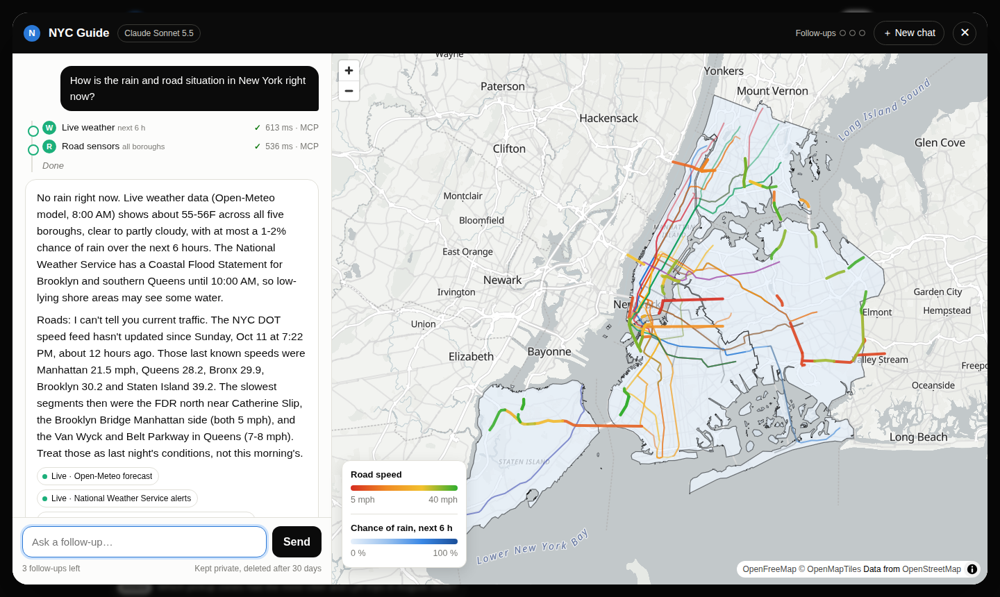
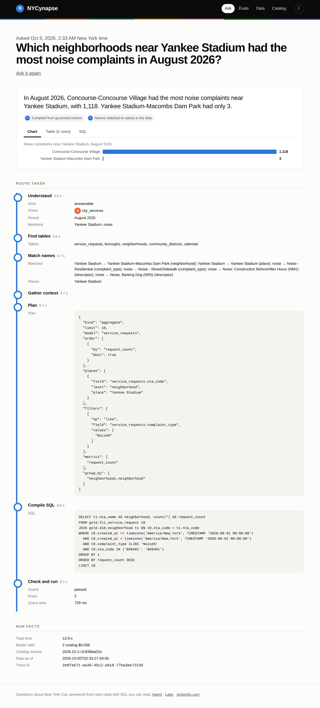

# NYCynapse.Ai

A guide to New York City you can ask anything. It answers from the city's own data first: the subway, the streets, the weather, Citi Bike, 311, crashes and a billion rows of history in [NYCynapse Lake](https://github.com/giridhar1103/NYCynapse_Lake). When a question is about right now, it reads live city feeds; only when neither has the answer does it search the web. Every fact in an answer carries a citation to its source with the time of the reading, and the places the answer talks about are numbered and highlighted on a map.

**Live:** [giriworks.com/nycynapse](https://giriworks.com/nycynapse/)

<picture>
  <source media="(prefers-color-scheme: dark)" srcset="docs/img/guide-dark.png">
  
</picture>

Under the guide is a QueryGPT-style text-to-SQL pipeline, following the path Uber described for [QueryGPT](https://www.uber.com/blog/query-gpt/) and the semantic layers that came after it: a question is never answered by handing a model the whole schema, but narrowed step by step to a domain, tables, values and joins, and only then SQL, checked before and after it runs. That pipeline is the guide's first and cheapest tool, and it is what the evaluation below measures.

## How the guide answers

The guide is a small, budgeted agent that works with any model provider. Each step, the model replies with JSON: a status line for the reader and either up to three tool calls, run in parallel, or the answer. Tool results, failures included, go back to it on the next step.

1. **The lake first.** `ask_lake` sends one precise question through the governed pipeline below and gets rows back. It knows what the lake covers, table by table, so it does not ask the lake about tonight.
2. **Live city feeds next.** Weather by borough with a week's forecast and alerts (Open-Meteo, National Weather Service), NYC DOT road speeds, 511NY closures and planned street events, train and bus service changes, MTA subway alerts with the hours each one applies, a trip planner, Census rent, income and population by ZIP code area, NYC Open Data and the city's address search.
3. **The web last.** Google results through Serper (Tavily and a self-hosted SearXNG behind it), and the text of the best pages, treated as untrusted material.
4. **Routes are planned, not guessed.** Directions and travel times come from `trip_plan`: transit itineraries from [Transitous](https://transitous.org), a public trip planner built on the agencies' own schedules with live times where they publish them, and typical taxi and app trip times for that hour between the two taxi zones, from the last three months of TLC trip records in the lake. JFK trips add the AirTrain leg from the Port Authority's figures and its alerts. Any figure in an answer that no tool returned sends the answer back to be rewritten, and is dropped if it comes back again.
5. **One answer.** Short and direct. Every source the tools return gets a number, the model cites facts with those numbers, and the page shows them as source pills; sources the answer did not use are left out. A mixed question ("rain and roads right now") is split and sent to the right tools in one step; a failed tool is reported and the agent tries another way.

Each tool result can carry map layers: boroughs, neighborhoods or ZIP codes shaded by value, points for stations and places, road segments colored by speed, subway lines with alerts lit up and moving, weather by borough over the rain radar. The answer also names the places it is about; they are matched to the city's neighborhood, ZIP code and borough outlines (or looked up as addresses and landmarks), numbered on the map, and the names in the text move the map to them.

| Limit | Value |
|---|---|
| Steps and calls per answer | 4 rounds, 7 calls; 2 web searches, 2 page reads, 3 lake questions |
| Time per answer | 150 seconds, then it answers with what it has |
| Conversation | A question and 3 follow-ups, with memory of earlier turns; ends after 30 minutes idle |
| Answers at once | 3, with a line of 10 that shows each reader their place, then a full-capacity message |
| Models | Claude Sonnet 5.5, with Gemini 3.7 Flash taking over when it is out of allowance |

The live and web tools run as an MCP server; the guide is an MCP host that connects to it, and falls back to calling the same functions directly if the server process dies. See [MCP servers](#mcp-servers).

Guardrails, from scope and prompt injection to page reads that cannot reach private networks, are in [docs/SECURITY.md](docs/SECURITY.md).

## The text-to-SQL pipeline

Used by the guide as `ask_lake`, by the MCP `ask` tool, and by the evaluation.

The pipeline is a [LangGraph](https://github.com/langchain-ai/langgraph) state graph. Each stage is a node, and every stage's output is streamed to the page and kept in a trace.

1. **Understand.** Classify the question (answerable, needs clarifying, outside the data, not a data question), pick the domains, and resolve the time window in New York time. "Last weekend" becomes two exact dates before any model sees a table.
2. **Find tables.** Hybrid retrieval over the catalog: vector search and full text search over names and descriptions, limited to the chosen domains.
3. **Match names.** Words in the question are matched to real values in the data with trigram search, so "loud parties" becomes `Loud Music/Party` and "the A" becomes route `A`. Named places resolve to fixed sets of neighborhoods, taxi zones and stations.
4. **Gather context.** Only the chosen models, their metrics and the joins between them, plus domain rules and reviewed examples of similar questions.
5. **Plan.** The model fills in a typed query plan (model, metrics, filters, groupings, places) instead of writing SQL. If the data cannot answer the question, it says so here and the pipeline declines with its reason.
6. **Compile SQL.** Code turns the plan into SQL: governed metric definitions, declared join paths, time filters that use the right column and time zone, and list columns unnested correctly. A model never invents a join.
7. **Check and run.** A guard parses the SQL and allows a single `SELECT` on gold tables only. The data's coverage is checked against the window, so a question about a month the data does not hold is declined instead of answered with zero. The query runs read-only; results are checked against each metric's plausible bounds.
8. **Repair.** An error, an empty result or an out of bounds value goes back to the planner with the reason, at most twice.
9. **Answer.** A short answer is written from the result, and every number in it is checked against the result table. Numbers that cannot be traced are flagged on the page.

<picture>
  <source media="(prefers-color-scheme: dark)" srcset="docs/img/trace-dark.png">
  
</picture>

## Results

<!-- results:start -->
**Dev**, 167 questions. Right answers, with 95% intervals.

| Model | E0 | E4 |
|---|---:|---:|
| Claude Opus 5.5 | 67.1% (59 to 75) | 76% (68 to 83) |
| Claude Sonnet 5.5 | 64.1% (56 to 72) | 74.3% (66 to 82) |
| Gemini 3.7 Flash | 59.3% (51 to 67) | 74.3% (66 to 82) |
| Claude Haiku 4.5 | 40.7% (33 to 49) | 70.1% (62 to 78) |
| GPT-5.6-Sol | 62.9% (55 to 71) | 70.1% (62 to 78) |
| GPT-6-Astra | 65.3% (57 to 73) | 70.1% (62 to 78) |
| GPT-6.1-Sol | 65.9% (58 to 74) | 70.1% (62 to 78) |
| Gemini 3.8 Flash | 56.3% (48 to 65) | 69.5% (61 to 77) |
| Gemini 3.1 Pro | 53.9% (45 to 62) | 62.9% (54 to 71) |
| GPT-6-Luna | 52.1% (43 to 61) | 61.1% (53 to 69) |
<!-- results:end -->

Ten models from three vendors, each run bare with the whole schema (E0) and inside the full pipeline (E4), one run each on the development questions. Every model does better with the pipeline, and the gain is largest for the smaller models: Claude Haiku 4.5 goes from 41% to 70%. The intervals are wide at this size, so the top three are not separable yet. Holdout results, repeated runs and the middle builds are being produced. Charts, latency, cost and results by question type are on the [evals page](https://giriworks.com/nycynapse/evals).

## Evaluation

The first 95 questions were written by hand before the pipeline, with reference SQL, across one table and joins, dates and periods, names and places, live feeds, and questions that should be declined: future dates, data the city does not publish, unsafe requests and questions that need clarifying. More were drafted by two models from other vendors and reviewed by hand. The rules every reference follows are in [`evals/CONVENTIONS.md`](evals/CONVENTIONS.md).

* **Splits.** 167 development questions used while building, 25 regression questions from earlier mistakes, and a holdout set kept outside the repository and never used while building. Paraphrases of the same question always land in the same split.
* **Audited answer key.** The strongest model of each vendor reviewed every reference answer, with the table documentation, the result and the conventions in front of it. Disagreements are settled by hand and logged in [`evals/audit/DECISIONS.md`](evals/audit/DECISIONS.md).
* **Frozen data.** Every run reads the lake at one pinned DuckLake snapshot, so live tables do not move the answers between runs.
* **Correct means the rows match.** The result is compared with the reference query's result as a multiset, with a tolerance for numbers and extra columns allowed. SQL that looks similar but returns different rows is wrong; different SQL that returns the same rows is right.
* **Five builds**, each adding one piece, run on the same questions:

| Build | What it adds |
|---|---|
| E0 | The full schema in the prompt, SQL written directly. The usual starting point. |
| E1 | Routing to a domain and only the tables that matter |
| E2 | Name matching, exact time windows, place resolution and the coverage check |
| E3 | Typed plans compiled to SQL from governed metrics and declared joins |
| E4 | Reviewed question and plan pairs, found by similarity, as examples |

Each run records the catalog version, prompt versions, model, latency, tokens and cost per question. `nycynapse eval-report` turns the raw runs into `evals/results/summary.json`, with 95% cluster bootstrap intervals and paired McNemar tests between builds and between models. Per-question results are published for the development and regression splits only, so holdout questions never reach the repository or the site.

## Semantic layer

Everything the system may know about the lake is declared in [`semantic/`](semantic):

| File | What it holds |
|---|---|
| `workspaces.yaml` | Ten domains (taxis and app rides, subway, Citi Bike, 311, traffic safety, road speeds, weather, data freshness, places, calendar) and the models in each |
| `models/` | 27 semantic models over the gold tables: time columns, keys, dimensions, measures and named filters |
| `metrics/` | 39 governed metrics with units, bounds and how they may be added up |
| `relationships.yaml` | 46 joins the planner is allowed to use |
| `time.yaml` | Named parts of the day and week, such as rush hour |
| `places.yaml` | Landmarks, venues, airports and stations people name, such as Yankee Stadium |
| `instructions.yaml` | Domain rules, such as how subway delay is signed or why taxi tips need card trips |
| `verified/queries.yaml` | Reviewed question and plan pairs used as examples |

A few choices worth calling out:

* **Metrics carry their additivity.** Precipitation adds up over hours but not across boroughs, so a citywide figure averages the boroughs instead of summing five weather stations. The compiler enforces this instead of trusting generated SQL to remember it.
* **Metrics can have several sources.** Trip counts come from the hourly zone aggregate when the question allows it, and fall back to the 650 million row trip table only when it needs something the aggregate does not carry.
* **Joins are declared, not invented.** Relationships include plain key joins, time joins (a crash to the weather in its borough that hour) and range joins (a subway arrival during a weather alert). Range joins can match more than one row, so they are applied as `EXISTS` filters and never inflate counts.
* **Places resolve before SQL is written.** "Near Yankee Stadium" becomes a fixed set of neighborhoods, taxi zones, subway stations and bike stations, worked out from the lake's boundaries when the catalog is built.

`semantic/gold_manifest.json` is a snapshot of the gold tables and their dbt documentation. `nycynapse check` parses every SQL fragment in the semantic layer with sqlglot and checks every column it names against that snapshot, so a renamed column in the lake fails CI here.

## Catalog

`nycynapse publish` validates the semantic layer and writes it to Postgres as a new catalog version:

* 372 objects (models, dimensions, metrics, relationships, places and so on), each with a short description, a 384-dimension embedding (`bge-small-en-v1.5`, run locally) and a full text index
* 16 thousand distinct values of the dimensions that need grounding, such as complaint types, station names and neighborhood names, indexed with trigrams
* the coverage of every named place

A version only becomes current once all of it is written. Older versions are kept because traces and evaluation runs record the version they used.

## Generated SQL cannot write

Generated SQL runs on a DuckDB connection with DuckLake attached read-only, network access and extension loading off, file access limited to the lake's data directory, and configuration locked. File access cannot be switched off completely, because DuckLake reads its own Parquet files, and DuckDB still allows `COPY ... TO` inside an allowed directory. So there are three more layers:

* a SQL guard that only lets a single `SELECT` on gold tables through, with a list of blocked functions
* the API service sees the lake directory mounted read-only by systemd
* its Postgres role can read the lake catalog and nothing else

## The site and API

A FastAPI service, with plain HTML, CSS and JavaScript pages and no build step, styled after transit signage. The landing page draws the city from the lake's own boundaries and the MTA's subway shapes, with Citi Bike docks and arriving trains from the last few minutes. The guide opens over it. Its map lights up the places an answer names as each line of the answer appears; bridges and tunnels are drawn from their OpenStreetMap outlines (© OpenStreetMap contributors, ODbL).

`GET /api/chat?q=&chat=` streams one turn as server-sent events: `chat`, `queue` (place in line), `status`, `tool` (each call starting and finishing, with errors), `lake` (the pipeline's stages inside a lake call), `map`, then `answer` or `error`. A comment line goes out every few seconds so proxies keep the stream open. The work runs in its own thread and gives its seat back when done, even if the reader has left.

Conversations are stored privately for 30 days and then deleted. Nothing one reader asks is shown to another. Example questions about past data are answered every morning after the daily data build and replayed; questions about right now are always answered live.

| Page | Shows |
|---|---|
| `/` | The landing page and the guide |
| `/evals` | The results above, by model and by question type |
| `/data` | How fresh every lake table is and recent gaps in live feeds |
| `/catalog` | The domains, models and governed metrics |
| `/trace?id=` | The route one pipeline answer took, with the plan, SQL, timings and cost |

The model provider is pluggable and set in a providers file, by role.

## MCP servers

Two stdio servers, both read-only, usable from Claude Desktop or any MCP client.

`nycynapse-mcp`, the lake:

| Tool | Does |
|---|---|
| `ask` | Runs the full pipeline and returns the answer, SQL, rows and checks, and keeps a trace |
| `domains` | Lists the domains, their models and example questions |
| `metric` | Shows how a governed metric is defined and where it comes from |
| `run_sql` | Runs one `SELECT` on gold tables through the same guard and read-only connection |

`nycynapse-tools`, the city right now and the web:

| Tool | Does |
|---|---|
| `weather` | Weather now and for the next hours by borough, a daily forecast up to a week ahead, and National Weather Service alerts |
| `road_speeds` | NYC DOT sensor speeds, by borough and the slowest segments, with how fresh the feed is |
| `road_events` | 511NY closures, roadwork, incidents and planned street events (parades, games, concerts), quoted as published (needs a 511NY feed login) |
| `subway_alerts` | MTA alerts in effect now with the hours each applies, plus changes starting in the next 12 hours, optionally for one line |
| `transit_changes` | 511NY service changes for LIRR, Metro-North, NJ Transit, subway and buses |
| `trip_plan` | Transit itineraries between two places (Transitous) and typical taxi times and fares for that hour (lake) |
| `find_place` | An address, landmark or venue: coordinates, neighborhood, borough |
| `area_stats` | ZIP code areas ranked by Census median rent, household income, population or share of renters, named by neighborhood |
| `open_data` | SoQL on six NYC Open Data datasets (311, crashes, permitted events, film permits, restaurant inspections, farmers markets) |
| `web_search` | Web search, Google results first |
| `read_page` | The main text of one public page; private network addresses are refused |

```json
{
  "mcpServers": {
    "nycynapse": {
      "command": "/path/to/NYCynapse/.venv/bin/nycynapse-mcp",
      "env": { "NYC_LAKE_PG_DSN": "...", "NYC_APP_PG_DSN": "..." }
    },
    "nyc-live": {
      "command": "/path/to/NYCynapse/.venv/bin/nycynapse-tools"
    }
  }
}
```

Keys for the live tools (Serper, Tavily, an NYC Open Data app token, a 511NY feed login) are read from a separate env file; any tool whose key is missing is simply left out.

## Running it

```bash
python3.12 -m venv .venv
.venv/bin/pip install -e ".[dev,mcp]"
set -a; . /path/to/env; set +a        # NYC_LAKE_PG_DSN, NYC_APP_PG_DSN

.venv/bin/nycynapse export-gold      # refresh the gold snapshot from the lake
.venv/bin/nycynapse check            # validate the semantic layer
.venv/bin/nycynapse publish          # write a new catalog version
.venv/bin/pytest -q

.venv/bin/nycynapse eval-pin                           # freeze a lake snapshot for evaluation
.venv/bin/nycynapse eval --system e4 --split dev \
    --model claude-sonnet-5.5                          # run a build over a split
.venv/bin/nycynapse audit-gold --split dev             # have three models review the answer key
.venv/bin/nycynapse eval-report                        # intervals, paired tests, the table above

.venv/bin/nycynapse export-geo                         # map outlines for the site, from the lake
.venv/bin/nycynapse chat "is the 7 running normally?"  # ask the guide in the terminal
.venv/bin/uvicorn nycynapse.api.app:app --port 8031    # the site and API
.venv/bin/nycynapse warm-examples                      # answer the example questions again
.venv/bin/nycynapse purge --days 30                    # delete old conversations
```

`deploy/` has the systemd units and the nginx configuration used in production.
